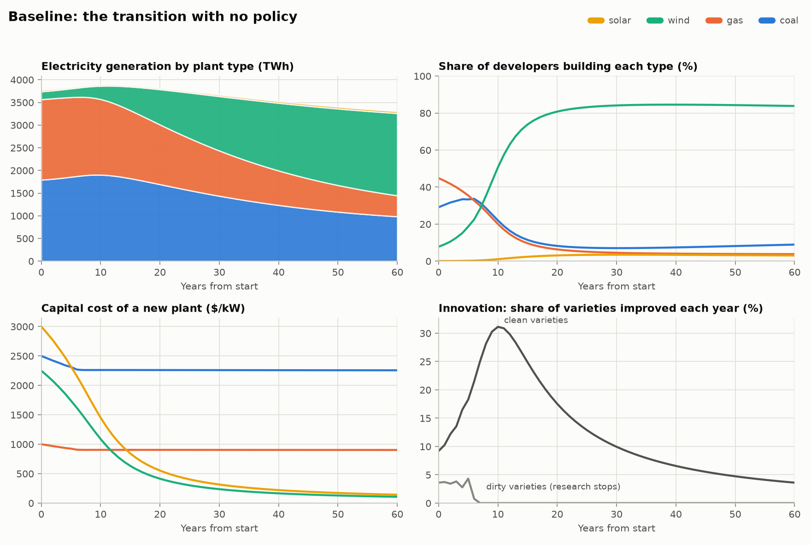
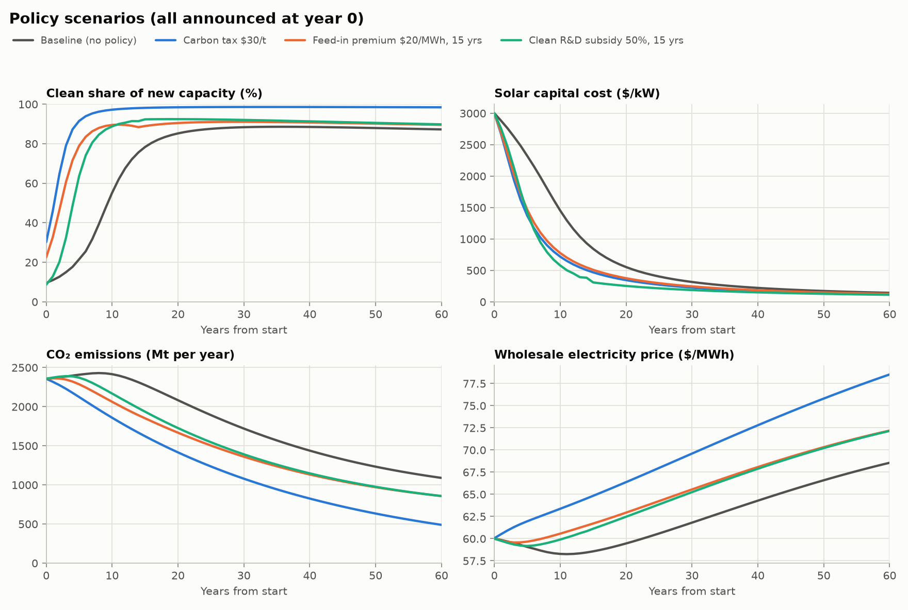

# TAFF: power-plant investment with directed innovation

A numerical implementation of the closed-economy model in
[`docs/model.tex`](docs/model.tex). Each year a mass of developers chooses
solar, wind, gas, coal or nothing (nested logit over project values). Plants
are built from clean or dirty capital varieties whose quality improves
through research. The equilibrium is solved as a perfect-foresight transition
path.




## Running it

```bash
pip install -r requirements.txt
python run.py --plot     # ~20 s: calibrate, solve 4 scenarios, write output/
```

Outputs:

| File | Contents |
|---|---|
| `output/results.csv` | one row per scenario x year: prices, capacity, generation, build shares, capex, innovation, emissions, fiscal flows |
| `output/summary.json` | calibrated parameters, model checks and headline numbers per scenario |
| `output/figures/*.png` | the two figures above |

To change a parameter or policy, edit `Params` in `taff/model.py`,
`Targets` in `taff/calibrate.py`, or `make_scenarios` in `run.py`.

## How it is solved

`taff/model.py` stacks the equilibrium conditions for t = 0..T-1 (T = 200)
into one system and solves it with Newton's method:

* **Unknowns:** log L^Y_t, S^c_t, S^d_t, and log K_{k,t+1} for each plant
  type (7T unknowns).
* **Derived from the unknowns:**
  * statics: Y, w, P^E, C and r;
  * quality aggregates, run forward;
  * project values Q^k and patent values v^z, run backward;
  * nested-logit shares and capex revenue R^z.
* **Residuals:**
  * labour-market clearing;
  * free entry of scientists in each sector, written as a complementarity
    condition (Fischer–Burmeister) because research in a sector can stop;
  * the capacity law of motion.
* **Terminal condition:** after T the economy is treated as stationary. Moving
  T from 200 to 280 changes the first 60 years by less than 1e-7.

Every solve reports these checks (`summary.json -> checks`):

* the largest residual, which is 1e-11 or smaller;
* Walras' law: the household budget C = wL + Π − T reproduces C = Y − fuel to
  1e-15;
* whether the interior-dispatch assumption P^E ≥ c^k holds in every period;
* the largest displacement probability ηS/M, which must be below 1.

## Calibration (illustrative, not estimated)

Units: $bn, GW, TWh. The starting point is a stylised large economy around
2010, where clean capital is expensive. `taff/calibrate.py` adds the targets
to the equilibrium system so that one Newton solve calibrates and solves at
the same time.

| Target | Value | Pins down |
|---|---|---|
| Wholesale electricity price at t=0 | $60/MWh | labour supply L |
| Solar capex at t=0 | $3,000/kW | initial clean quality Q^c_0 |
| Gas capex at t=0 | $1,000/kW | initial dirty quality Q^d_0 |
| Clean capital-cost decline, years 0–10 | 7%/yr | clean variety mass M^c |
| Dirty capital-cost decline, years 0–10 | 1%/yr | dirty variety mass M^d |

The other parameters are set directly:

| Parameter | Value |
|---|---|
| Capacity factors (solar, wind, gas, coal) | 0.18, 0.33, 0.45, 0.62 |
| Plant lifetimes | 25, 25, 30, 40 years |
| Capital per GW, ι | 1, 0.75, 1, 2.5 |
| Fuel prices | $15/MWh_th gas, $8/MWh_th coal |
| Thermal efficiencies | 0.50 gas, 0.37 coal |
| Electricity share β | 0.012 |
| Discount rate ρ | 0.05, log utility |
| Developers | D = 34 GW/yr, μ = $400/kW, λ = 0.8 |
| Varieties and innovation | σ = 5, γ = 0.3, η = 0.5 |

The carbon tax is in $/tCO2: τ^E e_k is the ad-valorem fuel tax, with
e_k = (tCO2 per MWh_th) / p^k.

## Scenarios (announced at t = 0)

| Scenario | Clean majority of new builds from | Emissions cut, first 50 yrs | Solar capex, year 10 | PV net fiscal cost |
|---|---|---|---|---|
| Baseline | year 10 | — | $1,452/kW | — |
| Carbon tax $30/t (phased in over 5 yrs) | year 2 | 29% | $719/kW | −$800bn (revenue) |
| Feed-in premium $20/MWh on clean output, 15 yrs | year 3 | 16% | $776/kW | $100bn |
| Clean R&D subsidy, 50% of the wage, 15 yrs | year 5 | 14% | $579/kW | $30bn |

All three policies raise discounted consumption slightly (by about 0.03%),
which means the no-policy path is not efficient in this model: variety firms
charge markups, and innovators do not capture the knowledge spillover of
raising the quality aggregate. The model has no climate damages, so none of
these numbers include the environmental benefit.

## Things the simulation revealed about the model

1. **Determinacy of the innovation block.** Combining free entry at t and
   t+1 with the patent-value recursion gives a difference equation in the
   displacement rate d_t = ηS_t/M:

   d_{t+1} = 1 + ηΓR_{t+1}/(σM w_{t+1}) − (w_t/w_{t+1})(1+r_{t+1})(1 + d_t G),
   with Γ = (1+γ)^(σ−1) and G = Γ − 1.

   The coefficient on d_t is −(1+r)G. When (1+r)G < 1, deviations die out
   going forward. Because S_t is a jump variable, a whole family of oscillating
   paths are all equilibria. This is the discrete-time creative-destruction
   cycle of Aghion and Howitt (1992): research tomorrow destroys the rents of
   today's innovators. With σ = 3 and γ = 0.3, (1+r)G ≈ 0.72, and the solver
   cannot pin the path down. At (1+r)G ≈ 1.31 the baseline solves, but the
   Jacobian is nearly singular: a feed-in premium of only $0.80/MWh had no
   nearby solution. The market-size feedback (cheaper clean capital, then more
   clean builds, then higher R^c) appears to erode the margin. The default
   σ = 5, γ = 0.3 gives 1.95, and every scenario then solves in a few seconds.
   **Possible fixes:** restrict parameters, move the innovation block to
   continuous time, or change the timing so that research at t+1 does not
   displace patents created at t.
2. **Zig-zag at the end of research.** Even when the equilibrium is
   determinate, the last few years before research in a sector stops
   oscillate. The dirty-sector line in the baseline figure shows this.
   It is the same mechanism, so the period-0 innovation rate is a fragile
   calibration target; that is why the calibration targets 10-year averages.
3. **Wind crowds out solar.** Both share one clean capital index, every
   project is 1 GW, and electricity is homogeneous. So the type with more MWh
   per dollar of capex (wind, with its higher capacity factor) wins every
   comparison, and solar never exceeds about 3% of builds. Matching solar's
   real-world rise would need separate solar and wind variety sectors (each
   with its own learning) or projects measured in energy rather than capacity.
4. **Rising electricity prices in the long run.** D is fixed in GW, and a GW
   of wind produces about half the energy of a GW of coal. As the fleet shifts
   to wind, total generation falls and P^E rises, from $60 to about $68/MWh by
   year 60 in the baseline. That higher price also keeps coal at about 9% of
   builds. Free entry of developers (the remark in Section 4) or D defined in
   energy terms would change this.
5. **The interior-dispatch assumption limits policy size.** At $30/t, coal's
   marginal cost is $49/MWh against a price of about $60, and the margin falls
   to $13/MWh along the path. A tax much above $40/t pushes coal's cost above
   P^E, so the model needs merit-order dispatch (plants that stop running)
   before it can study larger taxes. `checks.interior_dispatch` flags this.
6. **No cost floor.** All of a plant's capex comes from innovable varieties,
   so clean capex keeps falling toward zero (−95% by year 60). A
   non-innovable component (land, grid connection, installation labour) would
   put a floor under it.

## Layout

```
docs/model.tex       the model
taff/model.py        parameters, equilibrium residuals, Newton solver
taff/calibrate.py    calibration targets and solver
run.py               scenarios, results.csv, summary.json
figures.py           matplotlib figures
```
